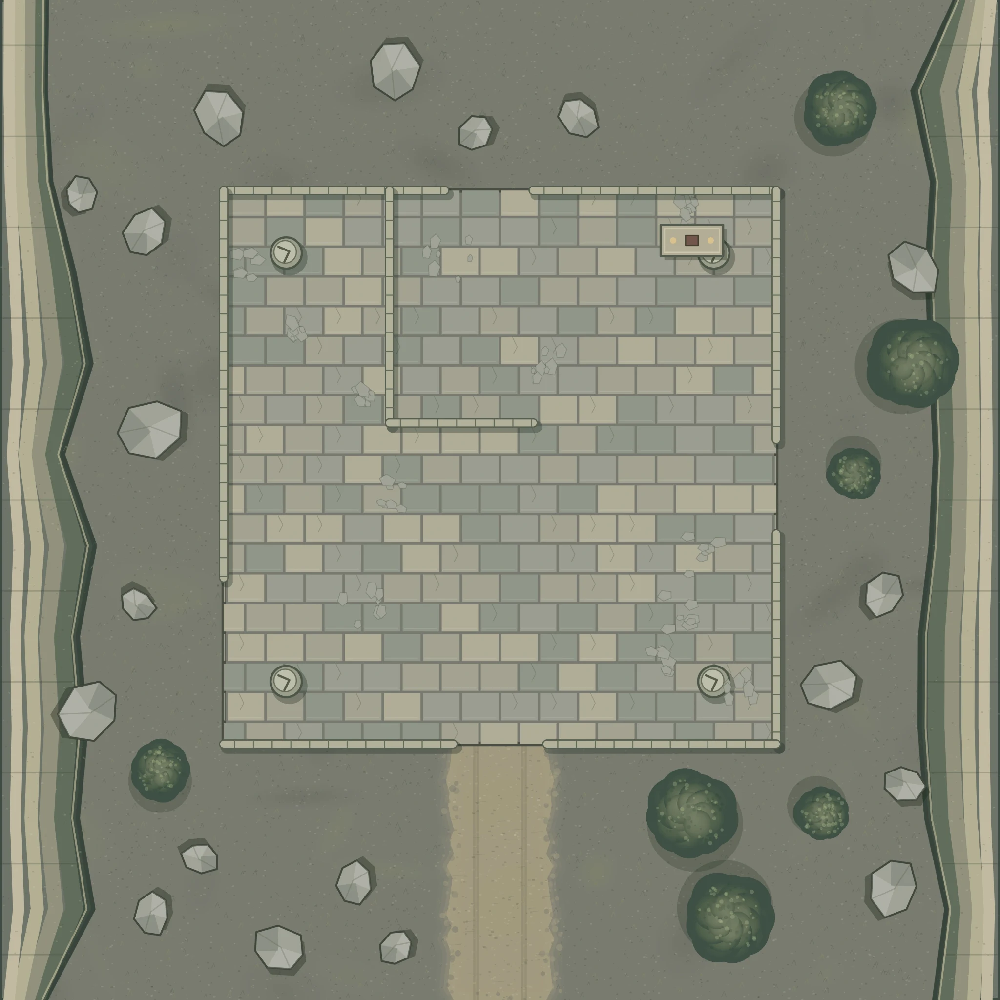

**Proposed, unplayed recovery job for [[Session 5 Prep - The Search Camp]].** It develops the orc-bandit hook in the unused expedition prep. The theft is separate from the caravan conspiracy. Nothing here establishes that the party was ordered killed or that the tower has been found.

## The job

[[Octavia Sere]] needs food and climbing equipment returned to the [[Expedition Site]]. [[Tavian Calvo]] identifies the goods; [[Renata Vellori]] records the agreement. The missing shipment was a local stores run, not one of the destroyed Berruel wagons.

A returning porter saw three armed orcs take the loads from the carriers and turn toward an abandoned quarry sorting yard. The carriers were allowed to leave. Tavian can bring the witness to the party and show the departure count. No roll is needed to obtain the essential lead.

**Cargo:** two blue-waxed food sacks and two squat tool chests marked with a diagonal white stripe. Together the sacks contain twenty-four sealed daily meal packets. The chests hold six coils of climbing rope, spare pitons, harnesses, and survey fittings. Tavian's list distinguishes this kit from whatever the raiders already owned.

**Agreed success:** recover both tool chests and at least one food sack. Tavian authorizes letting the raiders keep the other sack as part of a settlement. Recovering everything earns thanks but does not secretly change the promised price. Prisoners and dead raiders are not required.

The quarry is a proposed local encounter site, not a newly confirmed atlas landmark. Allow about two hours on foot from camp for this preparation, and choose its precise route only if the party needs it for the hexcrawl. Tavian loans carry frames and ordinary climbing gear. If nobody can carry the recovered stores safely, the party can secure the yard and fetch porters; that does not automatically cause another fight.

## Why the raiders are there

Rusha leads this three-person band sheltering in the old yard. They took the stores because they are short of food and intend to sell equipment they cannot eat. They know these sacks came from the expedition. They have no knowledge of the flask trap, the cargo insurance, or [[Cassian Merovel]].

Rusha is prepared to trade. She wants food and a promise that the camp will not immediately send guards after an agreed handover. She will not disarm her whole group while surrounded. Her two veterans distrust strangers but follow an agreement she makes in front of them. The scrapper wants to leave the mountains and is the first to argue for taking a sack and going.

These are the four combatants listed below. There are no hidden reinforcements, hostages, or extra warriors arriving because a negotiation succeeds.

> "If you've come for the iron, we can talk. If you've come for a hanging, say so before you step any closer."

## Approaching the yard

Use **Old Survey Quarry — Supply Recovery**, the prepared 32-by-32 map with 5-foot squares. It depicts a roofless stone sorting yard between steep rock faces. Its interior floor is one level. The north and south walls have open passages; wide breaks in the east and west walls offer other approaches. The L-shaped internal wall separates the northwest corner from part of the main floor.

The stone bench in the northeast is the sorting bench. The stolen sacks and chests are stacked on the floor south of it; represent them with the supplies token or a map note. The background artwork does not itself contain four painted crates. Broken columns and loose stone provide places to take cover; they are not automatic damaging hazards. Let the ordinary cover rules and the actual lines of sight decide each shot.

**Main trail:** the southern entrance is the easiest way to be seen and heard. A call from outside the yard reaches the raiders without requiring anyone to enter melee reach.

**Side approach:** the wall breaks offer a route around the main entrance. Use the actual walls and columns for Hide and Sneak. Raiders use their printed Perception DCs, and lose sight normally when a wall intervenes. Getting one person to the stores is easier than carrying four bulky loads away unnoticed.

**The trail itself:** the witness can lead the party, so a failed tracking check does not erase the adventure. If they leave without the witness, a **DC 16 Survival** check finds the carrying trail efficiently. Failure costs time and leads to a fresh patch of tracks; it does not summon an unrelated encounter.

## Three ways through

**A negotiated handover.** Rusha accepts one food sack, safe departure, and the return of the tools and remaining food to camp. A credible proposal that meets those terms needs no check. If the party tries to improve the bargain, use the normal social actions; Rusha's printed Will DC is **17**. She starts indifferent if hailed peacefully. Make an Impression can open a Request where her attitude would otherwise prevent it. One failed social roll does not make her attack. She can refuse a term, ask for a different guarantee, or give the party time to confer.

**A theft in return.** The party can distract the raiders and remove the stores. Decide where each raider is looking, then use ordinary Stealth and observation rather than a group roll that makes the whole group equally invisible. A discovered carrier can still set the load down, negotiate, run, or fight. The raiders protect their food and escape route; they do not pursue the party all the way to camp.

**A fight.** If someone begins violence, use the roster below. The objective remains the supplies. Rusha orders a retreat when two raiders are out of the fight, or if she falls below half HP and has a clear exit. Any raider may surrender when cut off. Their Ferocity can keep them standing; it does not oblige them to fight to the death.

## Encounter roster

This is **moderate for five level-2 PCs**: the adjusted budget is **100 XP**. Use the Monster Core versions, without elite or weak adjustments.

| Actor | Quantity | Level | XP each | Total |
| --- | --- | --- | --- | --- |
| Orc Commander, named Rusha | 1 | 2 | 40 | 40 |
| Orc Veteran | 2 | 1 | 30 | 60 |
| **Total** | **3** | | | **100** |

The commander and veterans have Reactive Strike, and all three have Ferocity. A creature still has only its normal reaction; using one of these reactions prevents using the other until it regains a reaction. Rusha can use Battle Cry to support the other orcs. Start with space between the groups and let the party see the available exits.

**GM reminder:** moderate describes the budget, not a guarantee of safety. Let the party rest at camp before taking the job. Do not add a cliff fall, damaging landslide, hidden reinforcements, or the three expedition NPCs to this budget. If Karoline or another ally joins the fight, reconsider the encounter for the actual participants; the default preparation assumes the five PCs handle it.

### Foundry placement

Token positions below are **token centers in scene pixels** on the prepared 3200-by-3200 scene, with north at the top. For a Medium 1-square token, subtract 50 from each coordinate when a tool expects its top-left position. The roster is staged only when the GM chooses; importing notes does not start combat.

| Token | Center X | Center Y | Position |
| --- | --- | --- | --- |
| Rusha — Orc Commander | 2050 | 1050 | Northeast main floor, south of the bench |
| Orc Veteran — South | 1750 | 2050 | Watching the southern approach |
| Orc Veteran — West | 1050 | 1650 | West of the internal wall, watching the broken wall |
| Stolen survey stores | 2250 | 1150 | South of the northeast bench; use a noncombat loot token or note |

A southern starting area for the party is centered around **(1550, 2650)**, outside the yard. Let players choose positions and another approach instead of forcing them into a fixed formation. Do not put tokens inside the east or west cliff blockers.

Compendium references for the installed PF2e Monster Core pack:

- Orc Commander: `Compendium.pf2e.pathfinder-monster-core.Actor.PLZk6zY5iwccPTPS`
- Orc Veteran: `Compendium.pf2e.pathfinder-monster-core.Actor.V90OYOMyyPLPJuod`

## Evidence and consequences

The white-striped chests and food seals establish that these are Tavian's stores. An ordinary departure slip inside a chest records the issue to the search crews. It has no link to the ambush payment. Do not treat an academy stamp as proof that Octavia ordered the caravan destroyed.

Rusha can give a consistent account of the theft and identify the path the carriers used. She has no useful answer about the caravan conspiracy. If the party handles a settlement honestly, she keeps the bargain and leaves with the agreed sack. A betrayed bargain costs the expedition a potential local contact and makes future raiders less willing to talk; it does not cause immediate revenge reinforcements.

If the party returns with only part of the goods, Tavian counts what was recovered before discussing the balance. If the party keeps the stores, Octavia asks for their return and Renata records the dispute. Access to camp stores can be suspended without inventing a magical punishment or declaring the entire camp hostile.

## Payment

For the agreed recovery, Octavia pays the same reward whether the party negotiated, stole the goods back, or fought:

- **24 gp**, paid to the party as a whole.
- **One runestone bearing a +1 weapon potency rune**: the rune is level 2 and worth 35 gp; the empty stone adds 3 gp, for **38 gp** together.
- **Two minor healing potions**, level 1, worth **4 gp each**.
- Meals and a camping place while the party assists the search, plus access to the existing survey information.

The tangible award is **70 gp total**, a portion of the level's treasure rather than a whole level's allowance. Count it alongside treasure already received in the dryad encounter and earlier sessions. The returned camp goods remain expedition property. Minor healing potions are vitality healing and do not restore Victarion's HP while he has Void Healing.

For an agreed partial settlement that meets the stated success terms, pay in full. For a smaller recovery, offer half the coin now and the rest when the remaining agreed goods arrive; do not withdraw the already-promised item reward after a reasonable rescue effort. If the table uses XP, resolving the moderate encounter awards **80 XP per PC**, including a comparable noncombat resolution. The campaign can instead continue using its established milestone decisions.

*Rules checked: GM Core encounter budgets and party-size adjustments; Monster Core Orc Commander and Orc Veteran. Equipment prices: [weapon potency](https://2e.aonprd.com/Equipment.aspx?ID=2830), [runestone](https://2e.aonprd.com/Equipment.aspx?ID=3003), and [healing potion](https://2e.aonprd.com/Equipment.aspx?ID=2943). The NPC motives, cargo, journey, agreement, and reward selection are proposed campaign preparation.*
